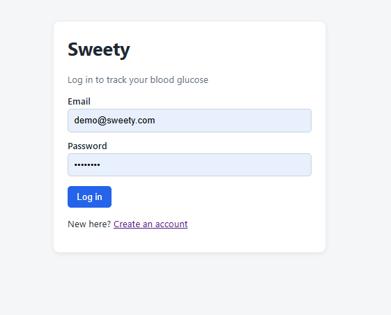
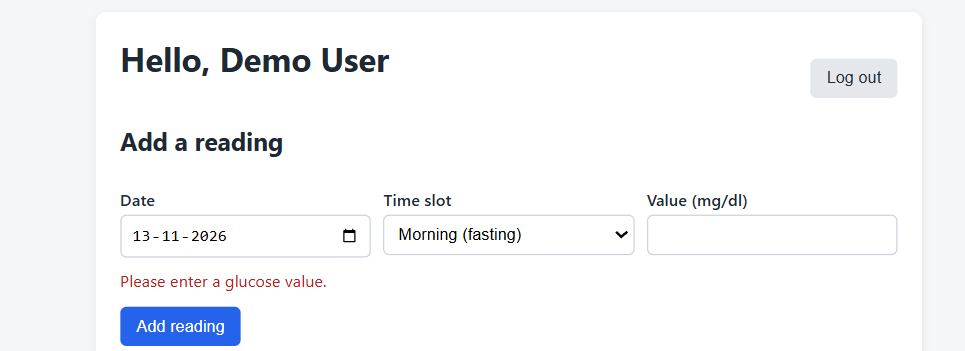
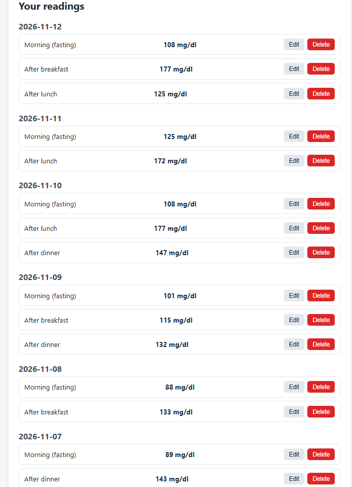
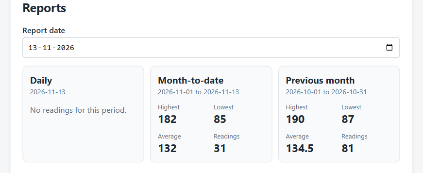

# Sweety – Blood Glucose Tracker

Sweety is a small web app for people with diabetes. You log up to four blood glucose readings a day (morning, after breakfast, after lunch, after dinner), then check daily, month-to-date and previous-month reports.

I built it as an assignment with **React** (Vite) on the front, **Node.js + Express** for the API and **PostgreSQL** for the database.

## What it does

- Sign up and log in (passwords are hashed with bcrypt, login uses a JWT)
- Add, edit and delete glucose readings (date, time slot, value in mg/dl)
- Every user only sees their own readings
- Validation with clear error messages shown on the form
- Reports with highest, lowest, average (1 decimal) and number of readings:
  - **Daily**: the selected date, plus a list of each reading with its slot
  - **Month-to-date**: 1st of the month up to the selected date
  - **Previous month**: the whole month before the selected date
- A friendly empty state when there are no readings
- A seed script that creates a demo user with sample readings
- Automated API tests (Jest + Supertest)

### Validation rules

| Rule | Message shown |
|---|---|
| Value is required | Please enter a glucose value. |
| Whole number between 40 and 600 | Value must be between 40 and 600 mg/dl. |
| One reading per slot per day | You already have a Morning reading for this date. |
| Max 4 readings per day | You can add only 4 readings per day. |
| Date can't be in the future | Date cannot be in the future. |

The form checks the simple rules right away. The rules that need the database (duplicate slot, 4 per day) are checked by the server. The server also repeats every check, so the rules hold even if someone skips the UI.

## Project structure

```
.
├── client/              React app (Vite)
│   └── src/
│       ├── pages/       Login, Register, Dashboard
│       ├── components/  ReadingForm, Reports, ProtectedRoute
│       ├── api.js       small fetch helper (adds the token)
│       ├── auth.js      login session helpers
│       └── constants.js slot names and date helper
└── server/              Express API
    ├── config/db.js     PostgreSQL connection
    ├── middleware/      JWT auth middleware
    ├── routes/          auth, readings, reports
    ├── tests/           API tests
    ├── schema.sql       database tables
    ├── seed.js          demo user + sample readings
    ├── app.js           Express app (used by tests too)
    └── server.js        starts the server
```

## Getting started

### What you need

- Node.js 20 or newer
- PostgreSQL (I used a local install)
- Git

### 1. Clone the repo

```bash
git clone https://github.com/<your-username>/<your-repo>.git
cd <your-repo>
```

### 2. Set up the database

Create a database (I called mine `reading_management`) and load the tables from `server/schema.sql`:

```bash
createdb -U postgres reading_management
psql -U postgres -d reading_management -f server/schema.sql
```

If you prefer, create the database in pgAdmin and run the contents of `schema.sql` in the query tool.

### 3. Set up and run the server

```bash
cd server
npm install
cp .env.example .env
```

Open `.env` and fill in your own values (see the table below). Then start the server:

```bash
npm start
```

You should see `Server running on port 5000`. Opening http://localhost:5000 shows "Server is running".

### 4. Set up and run the client

In a second terminal:

```bash
cd client
npm install
cp .env.example .env
npm run dev
```

Open the link Vite prints, usually http://localhost:5173.

> On Windows without `cp`, just copy `.env.example` to `.env` by hand.

### 5. Add demo data (optional)

```bash
cd server
npm run seed
```

This creates a demo user with about two months of readings:

- Email: `demo@sweety.com`
- Password: `Demo@123`

The dates are counted back from today, so the reports always have data. You can run the seed again whenever you like. It only removes and recreates the demo user, nobody else's data.

## Environment variables

**server/.env**

| Variable | What it is | Example |

| `PORT` | Port for the API | `5000` |
| `DB_HOST` | Database host | `localhost` |
| `DB_PORT` | Database port | `5432` |
| `DB_NAME` | Database name | `reading_management` |
| `DB_USER` | Database user | `postgres` |
| `DB_PASSWORD` | Database password | `your_password_here` |
| `JWT_SECRET` | Secret used to sign login tokens. Use a long random string | `your_long_random_secret_here` |

You can generate a good secret with:

```bash
node -e "console.log(require('crypto').randomBytes(32).toString('hex'))"
```

**client/.env**

| Variable | What it is | Example |

| `VITE_API_URL` | Where the API is running | `http://localhost:5000` |

Restart `npm run dev` after changing the client `.env`, because Vite only reads it on startup.

## Running the tests

```bash
cd server
npm test
```

The tests cover registration and login, every validation rule, one user not being able to see or delete another user's readings, and the report numbers.

**Heads up:** the tests use the same database as the app. They create two temporary users with random emails and delete them at the end, so your own data isn't touched. See the notes below.

## API overview

All `/readings` and `/reports` routes need a header: `Authorization: Bearer <token>`.

| Method | Route | What it does |

| POST | `/auth/register` | Create an account |
| POST | `/auth/login` | Log in, returns a token |
| GET | `/auth/me` | Current user |
| GET | `/readings` | List my readings (optional `?date=YYYY-MM-DD`) |
| POST | `/readings` | Add a reading |
| PUT | `/readings/:id` | Edit a reading |
| DELETE | `/readings/:id` | Delete a reading |
| GET | `/reports?type=daily\|mtd\|monthly&date=YYYY-MM-DD` | Report for that date |

Example body for adding a reading:

```json
{ "reading_date": "2026-11-10", "slot": "morning", "value": 110 }
```

Valid slots: `morning`, `after_breakfast`, `after_lunch`, `after_dinner`.

## Screenshots








## Notes

### Assumptions I made

- The assignment says "the whole previous month" for the monthly report, so I always use the month before the selected date. If the selected date is in January, that means December of the year before.
- "Date cannot be in the future" is checked against today's date in local time, and dates are kept as plain `YYYY-MM-DD` text so time zones can't shift them by a day.
- Passwords need at least 6 characters. Emails are lowercased so `A@x.com` and `a@x.com` are the same account.
- Login tokens last 1 day and are stored in the browser's `localStorage`. When one expires, the app sends the user back to the login page.
- When someone tries to edit or delete a reading that isn't theirs, the API answers "not found" instead of "forbidden", so it doesn't reveal that the reading exists.
- On the 4-per-day rule: if a day already has 4 readings, that message is shown instead of the duplicate-slot message.

### What I'd improve with more time

- Use a separate test database, so tests never run against the app's own database.
- Add frontend tests with React Testing Library for the reading form.
- Pagination on `GET /readings`, and a line chart of readings over the month.
- Add a `docker-compose.yml` so PostgreSQL and the app start with one command.
- Store the token in an httpOnly cookie instead of `localStorage`, and add rate limiting on login.
- Add a "forgot password" flow and a doctor role who can view their patients' reports.
- Polish the UI and make it more accessible.

### Bonus tasks

I focused on getting the required parts working and tested first, so I didn't attempt the optional bonus tasks.

---

Built by Jayasankar.